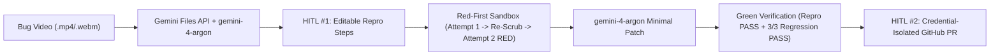

# ReproFix

> Autonomous screen-recording to Red-then-Green Playwright regression test and isolated Pull Request generator powered by Gemini 4 Argon.

## Features

* **Multimodal Screen-Recording Analysis**: Uploads `.mp4` / `.webm` bug recordings via the Gemini Files API (`client.files.upload`) and extracts timestamped reproduction steps, DOM selectors, expected vs. actual state, and root-cause hypotheses with `gemini-4-argon`, `gemini-3.8-flash` (DOM locator audit), and `gemini-3.5-flash-lite` (severity classification).
* **In-Browser Screen Recorder**: Built-in `navigator.mediaDevices.getDisplayMedia` + `MediaRecorder` tab capture so developers can record a live bug on the target app and analyze it in one click.
* **HITL #1 Interactive Step Editor**: Clickable timestamps seek the video player directly to each event; every action, selector, and expected assertion is editable before sandbox execution.
* **Mandatory Red-First Verification Loop**: Rejects false-positive tests (`FALSE_GREEN_REJECTED`) that accidentally pass on unpatched code, triggers a `gemini-4-argon` multimodal frame re-scrub on `bug_frame.jpg`, and enforces a deterministic failure (`CONFIRMED_RED`) before generating a patch.
* **Minimal Code Patch + Full Regression Suite**: Synthesizes a minimal unified diff with `gemini-4-argon`, verifies the new reproduction test flips from `FAIL` to `PASS`, and executes all 3 existing regression tests (`3/3 passed`).
* **Credential-Isolated PR Boundary (HITL #2)**: Registers `GITHUB_PAT` via `client.credentials.create` (`reprofix-github-pat`) and verifies `token_in_model_context: False` across all model prompts before publishing the Pull Request payload.
* **Dual-Mode Storage**: Persists jobs locally under `data/jobs/<job_id>/job.json` and automatically syncs artifacts and job documents to Google Cloud Storage (`gs://h2gdm-hack26icn-2655-assets/reprofix/`) and Cloud Firestore (`reprofix_jobs`).

## Architecture



## Prerequisites

* Python 3.11+ with `google-genai>=2.31.0`, `fastapi`, `uvicorn`, and `playwright`
* `ffmpeg` installed on `PATH`
* Valid `GEMINI_API_KEY` in `/Users/uno/Documents/github/google-ai-hack/.env`

## Installation

```bash
cd /Users/uno/Documents/github/google-ai-hack/reprofix
/Users/uno/Documents/github/google-ai-hack/.venv/bin/pip install -r requirements.txt
```

## Usage

Run the ReproFix server on port `8003`:

```bash
chmod +x run.sh
./run.sh
```

Open `http://127.0.0.1:8003` in your browser.

To regenerate the real Playwright bug screen recordings or pre-computed demo jobs:

```bash
/Users/uno/Documents/github/google-ai-hack/.venv/bin/python seed_recordings.py
/Users/uno/Documents/github/google-ai-hack/.venv/bin/python precompute_demos.py
```

## Configuration

| Variable                         | Description                                               |
| -------------------------------- | --------------------------------------------------------- |
| `GEMINI_API_KEY`                 | API key for Gemini 4 Argon & companion models             |
| `GOOGLE_APPLICATION_CREDENTIALS` | ADC JSON path for Cloud Storage and Cloud Firestore sync  |
| `GCP_PROJECT_ID`                 | GCP project ID (`h2gdm-hack26icn-2655`)                   |
| `GCS_BUCKET_NAME`                | GCS bucket for video/screenshot artifacts                 |
| `GITHUB_PAT`                     | Optional GitHub token isolated at the proxy boundary      |

## Project Structure

```text
reprofix/
├── app.py                  # FastAPI server (port 8003) & REST API endpoints
├── analyzer.py             # Gemini Files API upload + Argon/Flash/Flash-Lite analysis
├── sandbox_runner.py       # Red-First enforcement loop + Argon patch + Playwright runner
├── pr_creator.py           # Credential-isolated GitHub PR boundary & prompt auditor
├── storage.py              # Dual-mode Local JSON + GCS + Firestore persistence
├── seed_recordings.py      # Headless Playwright + ffmpeg real bug video generator
├── precompute_demos.py     # Pre-computes instant demo jobs with real Argon calls
├── static/index.html       # ReproFix Developer Dashboard UI
├── demo_target_app/        # Buggy target web app ("TaskFlow Pro") + 3 regression tests
└── data/                   # Recordings, sandboxes, and job artifacts
```
